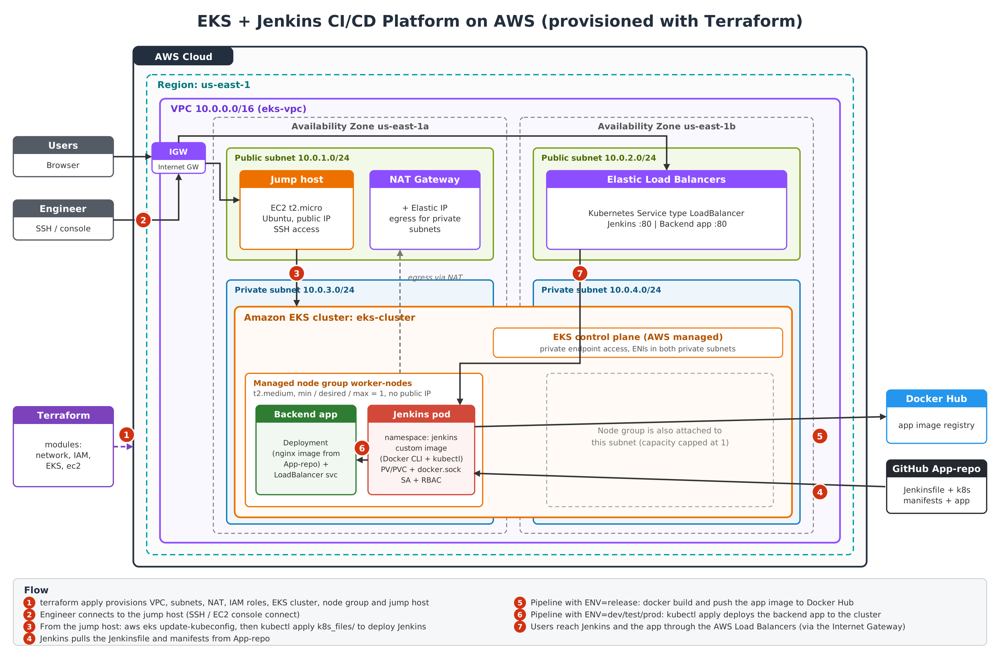

# eks-jenkins-cicd-terraform

Terraform-provisioned **Amazon EKS** platform on AWS that runs a **Jenkins CI/CD server inside the cluster** (custom Docker image with Docker CLI + kubectl) and deploys a containerized backend app through a parameterized Jenkins pipeline.

    

> This repo is the **infrastructure and platform** half of the project.
> The application, `Dockerfile` and `Jenkinsfile` live in **[App-repo](https://github.com/Mustafa-Essam223/App-repo)**.

---

## Architecture



**Flow:** Terraform builds the network, IAM roles, EKS cluster and a jump host. From the jump host you deploy Jenkins to the cluster with `kubectl`. Jenkins then pulls the `Jenkinsfile` from `App-repo`, builds and pushes the app image, and deploys it back to the same cluster behind a LoadBalancer.

---

## What gets created

| Layer | Resources |
|---|---|
| **Network** (`infrastructure/network`) | VPC `10.0.0.0/16`, 2 public + 2 private subnets across 2 AZs, Internet Gateway, NAT Gateway + Elastic IP, public/private route tables, security group (inbound 22, 80, 443, 30357). Subnets carry the `kubernetes.io/...` tags that EKS and load balancers need. |
| **IAM** (`infrastructure/IAM`) | EKS cluster service role (`AmazonEKSClusterPolicy`) and worker-node role (`AmazonEKSWorkerNodePolicy`, `AmazonEKS_CNI_Policy`, `AmazonEC2ContainerRegistryReadOnly`). |
| **EKS** (`infrastructure/EKS`) | Cluster `eks-cluster` on the two **private** subnets, plus a managed node group (1 × `t2.medium`) with SSH key access. Nodes have no public IPs and reach the internet through the NAT gateway. |
| **Jump host** (`infrastructure/ec2`) | Public EC2 instance (Ubuntu, `t2.micro`) used to reach the cluster and apply Kubernetes manifests. |
| **Jenkins on Kubernetes** (`k8s_files/`) | `jenkins` namespace, service account + RBAC, PV/PVC for `/var/jenkins_home`, Deployment, and a `LoadBalancer` Service exposing Jenkins on port 80. |
| **Jenkins image** (`Dockerfile`) | `jenkins/jenkins:lts-jdk11` plus the Docker CLI and `kubectl`, so pipelines can build images and deploy to the cluster. |

---

## Repository structure

```text
.
├── Dockerfile                  # Custom Jenkins image (Docker CLI + kubectl)
├── infrastructure/             # Terraform root module
│   ├── main.tf                 # Provider + wiring of all modules
│   ├── network/                # VPC, subnets, IGW, NAT, routes, security group
│   ├── IAM/                    # EKS cluster role and node-group role
│   ├── EKS/                    # EKS cluster + managed node group
│   └── ec2/                    # Jump host
└── k8s_files/                  # Jenkins manifests
    ├── ns.yaml                 # Namespace: jenkins
    ├── sa.yaml                 # ServiceAccount + ClusterRole + ClusterRoleBinding
    ├── jenkins-pv.yml          # PersistentVolume
    ├── jenkins-pvc.yml         # PersistentVolumeClaim
    ├── jenkins_deployment.yaml # Jenkins Deployment (mounts docker.sock)
    └── loadbalancer.yaml       # LoadBalancer Service (80 -> 8080)
```

---

## Prerequisites

- An AWS account with credentials in `~/.aws/credentials` and `~/.aws/config`
- [Terraform](https://developer.hashicorp.com/terraform/install)
- An existing EC2 key pair named **`GradKey`** in `us-east-1` (or change `ssh_key` in `infrastructure/main.tf` and `my-key-name` in `infrastructure/ec2/variables.tf`). Place the matching `GradKey.pem` in `infrastructure/`; the jump host provisioner uses it to connect over SSH.
- A Docker Hub account (only needed for the `release` pipeline option)

---

## Deployment

### 1. Provision the infrastructure

```bash
git clone https://github.com/Mustafa-Essam223/eks-jenkins-cicd-terraform
cd eks-jenkins-cicd-terraform/infrastructure
terraform init
terraform plan
terraform apply
```

### 2. Connect to the cluster from the jump host

Connect to the `Jumb-Host` instance (EC2 console connect or SSH), make sure the AWS CLI and `kubectl` are installed on it, and configure credentials. Then:

```bash
aws eks --region us-east-1 update-kubeconfig --name eks-cluster
kubectl get nodes
```

### 3. Deploy Jenkins

The namespace has to exist before the namespaced resources, so apply in this order:

```bash
git clone https://github.com/Mustafa-Essam223/eks-jenkins-cicd-terraform
cd eks-jenkins-cicd-terraform/k8s_files

kubectl apply -f ns.yaml
kubectl apply -f sa.yaml
kubectl apply -f jenkins-pv.yml
kubectl apply -f jenkins-pvc.yml
kubectl apply -f jenkins_deployment.yaml
kubectl apply -f loadbalancer.yaml
```

### 4. Unlock Jenkins

```bash
kubectl get pods -n jenkins
kubectl logs -n jenkins <jenkins-pod-name>     # initial admin password is printed here
kubectl get svc -n jenkins                      # EXTERNAL-IP = Jenkins URL
```

Open the LoadBalancer DNS name in a browser and sign in with the initial admin password.

### 5. Run the application pipeline

1. In Jenkins, add a **Username with password** credential with ID `DockerHub-Account`.
2. Create a Pipeline job that uses the `Jenkinsfile` from [App-repo](https://github.com/Mustafa-Essam223/App-repo).
3. Run it with the `ENV` parameter:

| `ENV` | What the pipeline does |
|---|---|
| `release` | Builds the app image and pushes it to Docker Hub |
| `dev` / `test` / `prod` | Applies the app Deployment and LoadBalancer manifests to the cluster with `kubectl` |

The app is then reachable on the new LoadBalancer DNS name (`kubectl get svc`).

### Clean up

```bash
kubectl delete svc -n jenkins jenkins-nodeport   # release the AWS load balancer first
cd infrastructure && terraform destroy
```

---

## Design notes

- **Private worker nodes:** EKS nodes live in private subnets and reach the internet only through the NAT gateway.
- **Modular Terraform:** network, IAM, EKS and EC2 are separate modules, wired together in the root `main.tf` with explicit dependencies.
- **Jenkins runs in the cluster it deploys to:** the pod's service account has RBAC permissions to apply manifests, and the custom image carries `kubectl`.
- **Docker builds in the pipeline:** the node's `docker.sock` is mounted into the Jenkins pod so pipeline stages can run `docker build` and `docker push`.

---

## Known limitations and planned improvements

This is a learning/portfolio environment. Before using the same pattern anywhere real:

- [ ] **Remote Terraform state:** add an S3 backend with DynamoDB locking (state is currently local).
- [ ] **Tighten the security group:** restrict SSH (22) to a trusted IP instead of `0.0.0.0/0`.
- [ ] **Least-privilege RBAC:** replace the wildcard `ClusterRole` for Jenkins with a scoped role.
- [ ] **Safer Docker builds:** replace the host `docker.sock` mount with a rootless builder such as Kaniko or BuildKit.
- [ ] **Persistent storage:** use an EBS-backed StorageClass instead of a `hostPath` PersistentVolume.
- [ ] **Automate the jump host:** install the AWS CLI and `kubectl` during provisioning.
- [ ] **Multi-node node group** and parameterized variables for region, instance types and key name.

---

## Tech stack

AWS (EKS, VPC, IAM, EC2, NAT/IGW, ELB) · Terraform · Kubernetes · Jenkins · Docker · Shell · Git

## Author

**Mustafa Essam**: [GitHub](https://github.com/Mustafa-Essam223)
